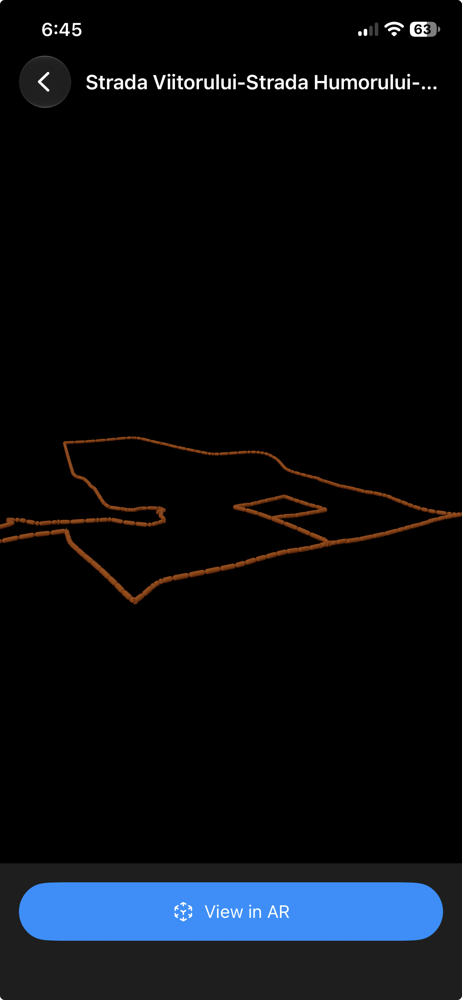
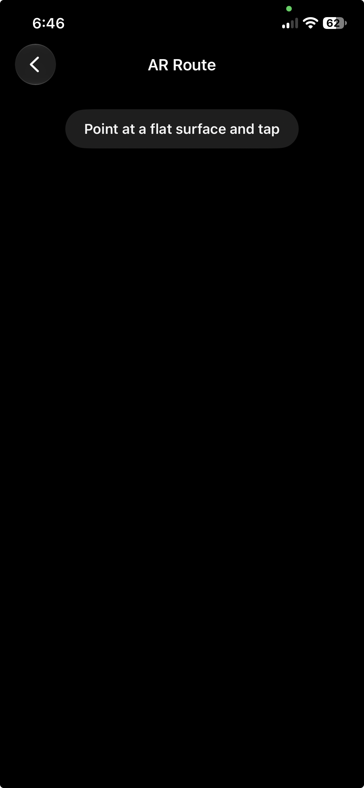
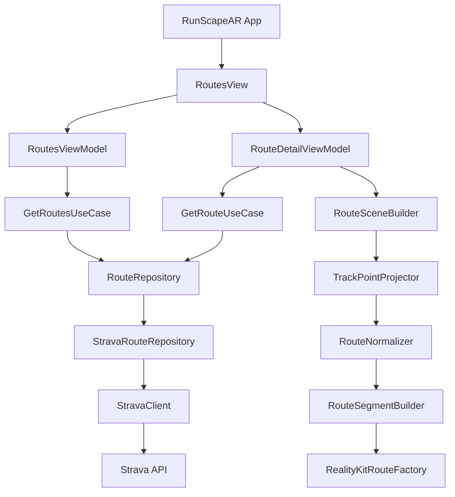
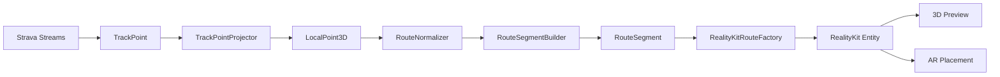

# RunScape AR

<p align="left">
  
  
  
  
</p>

RunScape AR is a native iOS application that transforms Strava routes into interactive 3D models and augmented reality experiences.

A route fetched from Strava is converted from geographic coordinates into local 3D geometry, normalized for tabletop visualization, rendered with RealityKit, and optionally placed on a real-world surface using ARKit.

## Demo

### Strava Routes

Browse routes loaded directly from the authenticated Strava account.


### Interactive 3D Route

Routes are converted from geographic coordinates into normalized local 3D geometry and rendered with RealityKit.



### Augmented Reality

The same route geometry can be placed on a detected real-world horizontal surface using ARKit.



## Features

- Strava route integration
- Strava activity integration
- Route and activity stream decoding
- Interactive 3D route preview
- Augmented Reality route placement
- Elevation-aware route geometry
- Pan and pinch camera controls
- Clean Architecture
- Swift Package Manager modularization
- Unit and opt-in integration tests
- SwiftLint and SwiftFormat quality gates

## Tech Stack

- Swift 6
- SwiftUI
- ARKit
- RealityKit
- Observation
- URLSession
- Swift Package Manager
- Swift Testing
- SwiftLint
- SwiftFormat

## Architecture

RunScape AR follows a modular Clean Architecture approach.



```text
RunScapeAR/
├── Apps/
│   └── RunScapeAR/
│
├── Packages/
│   ├── Domain/
│   ├── DataLayer/
│   └── Platform/
│
├── Scripts/
├── .swiftformat
└── .swiftlint.yml
```

### Domain

Contains platform-independent business models, repository contracts and use cases.

Examples:

- `Route`
- `RouteSummary`
- `Activity`
- `ActivitySummary`
- `TrackPoint`
- `GetRoutesUseCase`
- `GetRouteUseCase`

### DataLayer

Responsible for external data access.

```text
Strava API
    ↓
DTO
    ↓
Mapper
    ↓
Repository
    ↓
Domain
```

Includes:

- HTTP client abstraction
- Strava API client
- Route and activity DTOs
- Stream decoding
- Repository implementations
- Unit and integration tests

### Platform

Contains Apple platform-specific functionality.

```text
TrackPoint[]
    ↓
TrackPointProjector
    ↓
LocalPoint3D[]
    ↓
RouteNormalizer
    ↓
RouteSegmentBuilder
    ↓
RealityKitRouteFactory
    ↓
Entity
```

Responsibilities include:

- Geographic coordinate projection
- Route normalization
- 3D geometry generation
- RealityKit rendering
- AR route scene construction

## 3D Route Pipeline



## Application Flow

```text
Strava
  ↓
Routes
  ↓
Route Detail
  ↓
Interactive 3D Preview
  ↓
View in AR
  ↓
ARKit Surface Detection
  ↓
Tap Surface
  ↓
3D Route Placement
```

## Development Setup

### Requirements

- macOS
- Xcode
- iOS 17+
- Swift 6
- Homebrew

Install development tools:

```bash
brew install swiftlint swiftformat
```

### Code Quality

Format:

```bash
./Scripts/format.sh
```

Check formatting:

```bash
./Scripts/check-format.sh
```

Lint:

```bash
./Scripts/lint.sh
```

## Tests

Each package can be tested independently.

```bash
cd Packages/Domain
swift test

cd ../DataLayer
swift test

cd ../Platform
swift test
```

Strava integration tests are disabled by default so the standard test suite remains deterministic.

To enable them:

```bash
RUN_STRAVA_INTEGRATION_TESTS=1 swift test
```

A valid `STRAVA_ACCESS_TOKEN` must also be provided through the local environment.

## Strava Configuration

RunScape AR communicates with the Strava API.

Credentials must never be committed to the repository.

For local development, provide:

```text
STRAVA_ACCESS_TOKEN
```

through Xcode Scheme environment variables or your local shell.

Do not commit:

- Access tokens
- Refresh tokens
- Client secrets
- OAuth authorization codes

## AR Testing

The non-AR 3D route preview can be tested in the iOS Simulator.

Actual AR features such as plane detection and route placement require a physical ARKit-compatible iPhone.

## Current Status

Implemented:

- [x] Domain layer
- [x] Strava networking
- [x] Route repositories
- [x] Activity repositories
- [x] Route and activity stream parsing
- [x] Interactive 3D route preview
- [x] AR route placement
- [x] SwiftLint / SwiftFormat
- [x] Unit test suite
- [x] Opt-in Strava integration tests

Planned:

- [ ] Strava OAuth login
- [ ] Keychain token storage
- [ ] Automatic token refresh
- [ ] Route placement reset/reposition
- [ ] AR interaction improvements
- [ ] Route statistics overlay
- [ ] Elevation and gradient visualization
- [ ] Activity replay
- [ ] MapKit route visualization

## Security

Secrets and credentials must remain outside source control.

Local Xcode and SwiftPM metadata containing environment variables should remain ignored by Git.

## License

License information will be added before public release.
